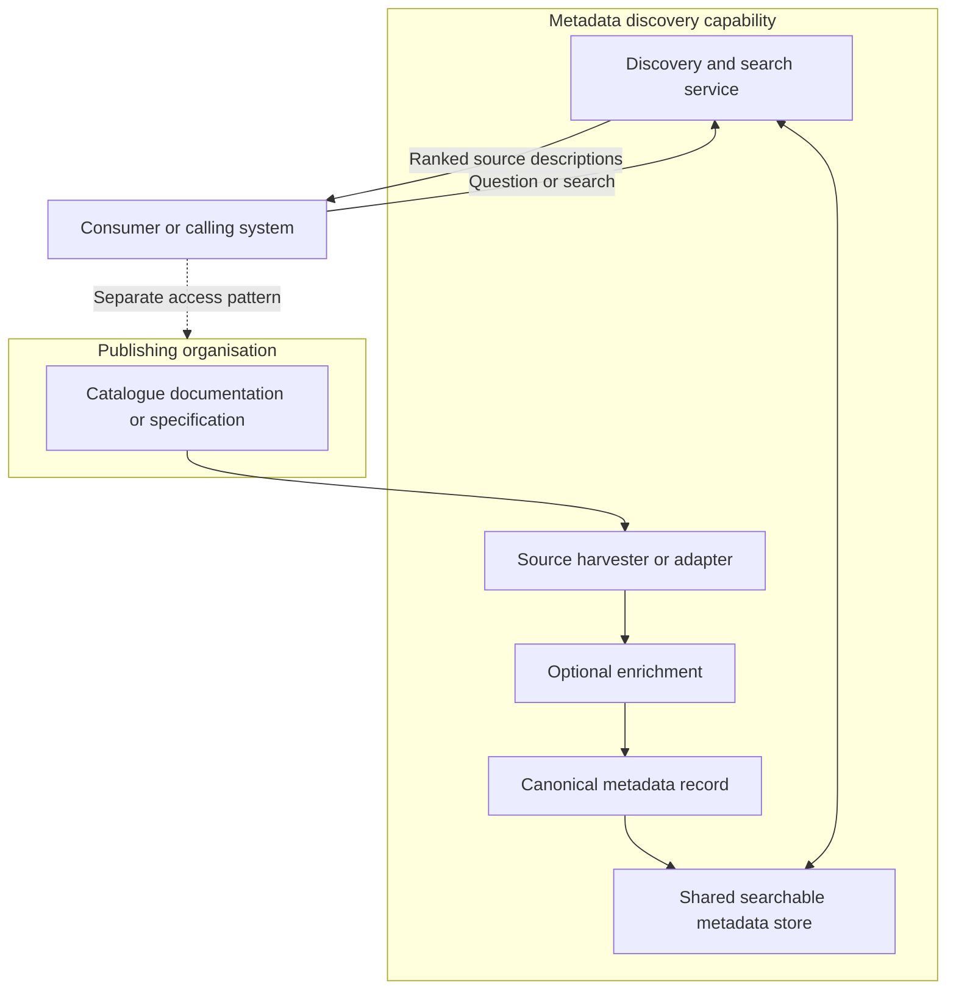
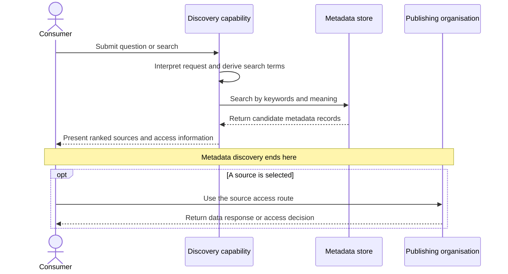
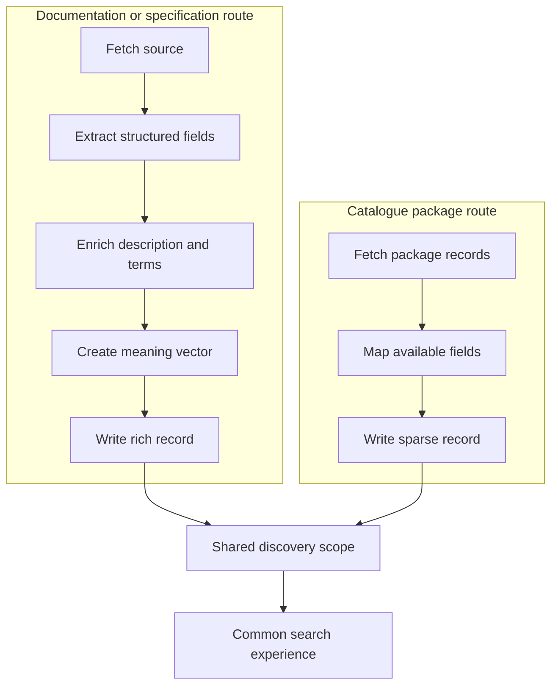

# Metadata Based Discovery of Data Sets and Sources

**Pattern type:** Data Access Pattern  
**Audience:** Data, technology, policy, legal and governance communities  
**Status:** Draft pattern definition  
**Owner:** Government Digital Service Data Architecture function  
**Version:** 1.0  
**Date:** September 2026

## Executive summary

Government data is published by many autonomous organisations through catalogues, websites, documentation and machine-readable specifications. A person or system looking for relevant data may not know which organisation holds it, what terminology that organisation uses, or whether the source is suitable for the intended purpose.

This pattern establishes a common metadata discovery capability without requiring publishers to move their underlying data or give up ownership of their source systems. Metadata is information that describes a data set or service, such as its title, purpose, publisher, subject, access route and update status. The capability collects this descriptive information, maps it to a shared record structure, optionally enriches sparse descriptions, and makes the combined records searchable through words and meaning.

The result of this pattern is a ranked list of potentially relevant sources with enough information to support assessment and selection. Discovery ends at that point. Obtaining records through an application programming interface, linking records, combining data for analysis, or subscribing to changes belongs to a separate access pattern.

## 1 Name and intent

### Pattern name

Metadata Based Discovery of Data Sets and Sources

### Intent

This pattern enables people and systems to find and assess relevant data sets, data services and application programming interfaces across independently managed organisations.

An application programming interface, or API, is a defined way for one software system to request information or services from another. Metadata discovery may identify an API, but it does not itself call the API or transfer the underlying data.

The pattern supports two complementary outcomes:

- publishing organisations can make their sources easier to find while retaining ownership and control; and
- consumers can search across organisational boundaries without knowing the publisher, catalogue, technical format or exact vocabulary in advance.

## 2 Context

Government data is distributed across departments, agencies, arm's-length bodies and local organisations. Each publishing organisation remains accountable for its data and may use its own catalogue, website, documentation style, metadata standard and access mechanism. There is no single owner of all government data and no assumption that all publishers will migrate to one platform.

Consumers may be analysts, policy professionals, operational teams, researchers, service teams, data architects or calling systems. They often begin with a question or information need rather than the name of a known data set. A consumer may therefore need to search across multiple publishers and assess the returned descriptions before deciding whether any source is relevant.

This pattern sits within the data discovery family of the Data Access Patterns collection. It concerns the publication and assessment of metadata. It does not prescribe an exhaustive government catalogue, mandate a particular metadata standard, or copy the underlying data into a shared warehouse.

## 3 Problem statement

### Consumer problem

A consumer does not know that a relevant data set or service exists, where it is published, whether it is likely to answer the question, or how access can be requested. Exact-word search is often insufficient because organisations describe similar subjects using different terms.

### Publisher problem

A publishing organisation wants its data to be found and used appropriately, but must retain ownership, accountability and control. Requiring every publisher to replace its local catalogue or adopt one central technology would create cost, delay and organisational resistance.

### Architectural problem

The discovery capability must present records from different sources as a coherent search experience even when their native metadata varies in structure, richness and quality. It must also maintain a clear boundary between a description of a source and the source's actual access endpoint.

## 4 Forces

The solution balances the following competing pressures.

| Force | Architectural implication |
| --- | --- |
| One search experience is needed across government | Metadata from different publishers requires a common discovery surface. |
| Publishers retain ownership and local autonomy | The approach must harvest or receive metadata rather than require migration of underlying data. |
| Source metadata varies in richness | A common minimum record and an optional enrichment step are needed. |
| Consumers use different words from publishers | Keyword search benefits from being supplemented by meaning-based search. |
| Enrichment and meaning-based search add cost and complexity | These capabilities must be applied consistently and only where they add sufficient value. |
| Multiple ingestion routes are necessary | Every route must conform to the same record and searchable-store contract. |
| Metadata becomes stale | Ownership, refresh, withdrawal and change detection require explicit governance. |
| Generated descriptions improve findability but may be imperfect | Generated content must be identifiable and traceable to its source. |
| Search intent can be uncertain | Confidence must inform an explicit routing, fallback or review decision if it is used as a control. |
| Discovery and access are closely related | The handoff must be clear so that a documentation page is not treated as a callable data endpoint. |

## 5 Solution structure

The solution creates a shared search experience over metadata that remains connected to independently owned sources. It consists of five main stages.

1. **Acquire metadata.** A source-specific harvester or adapter reads a catalogue record, documentation page or machine-readable specification.
2. **Normalise the record.** The adapter maps source fields to a shared canonical metadata record. Canonical means a consistent internal structure used across all participating sources.
3. **Enrich where necessary.** Sparse metadata may be supplemented with a plain-language summary, additional search terms, suggested uses or a numeric representation of meaning. Generated fields remain distinguishable from publisher-supplied facts.
4. **Index and search.** Every accepted record is written to the searchable scope used by the discovery service. A request can be matched using keywords and, where available, similarity of meaning.
5. **Return candidates and hand off.** The service returns ranked source descriptions. A separate pattern governs any later access, linkage, combination or subscription activity.

### 5.1 Pattern structure

The publishing organisation remains the authority for the source and its authoritative metadata. The discovery capability holds descriptive records needed for search, not a replacement copy of the underlying data.

### 5.2 Discovery interaction

### 5.3 Canonical metadata record

The exact schema may vary by implementation, but the shared record requires enough information to support identification, assessment, search and a safe handoff to access. The following logical structure is recommended for the pattern.

| Information group | Example fields | Purpose |
| --- | --- | --- |
| Identity | Record identifier, title, source type | Distinguishes the described source and supports deduplication. |
| Ownership | Publisher, responsible contact | Identifies who owns and can correct the metadata. |
| Description | Description, plain-language summary, subject, tags | Explains what the source contains and supports search. |
| Location | Documentation address, catalogue record address | Points to information about the source. |
| Access | Access method, live endpoint address, authentication type | Explains how a selected source may be accessed without confusing documentation with an endpoint. |
| Fitness for use | Coverage, format, update information, limitations | Helps a consumer judge relevance and suitability. |
| Provenance | Original source, harvested time, field origin, enrichment method | Shows where each value came from and whether it was generated. |
| Lifecycle | Last checked, status, withdrawal indicator | Supports freshness and removal decisions. |
| Search | Combined search text, optional meaning vector | Enables keyword and meaning-based retrieval. |
| Assessment | Completeness measure, validation status | Separates record completeness from factual quality or accuracy. |

Only fields supported by publisher metadata or clearly marked enrichment are presented as facts. A completeness measure indicates whether expected fields are present; it does not by itself establish accuracy, authority or fitness for a particular use.

### 5.4 Essential implementation rules

- All ingestion routes write records that conform to one centrally owned metadata contract.
- All accepted records become visible through the normal discovery query scope.
- Publisher-supplied, derived and artificially generated fields are distinguished through provenance.
- Documentation locations, catalogue locations and callable access endpoints use separate fields.
- Search ranking does not imply source quality, permission to access, or suitability for a decision.
- Metadata refresh and source withdrawal are designed as lifecycle capabilities rather than left to ad hoc manual action.
- Where intent confidence is calculated, defined thresholds drive a stated outcome such as broad search, clarification, fallback or human review.

## 6 Participants and responsibilities

| Participant | Responsibilities |
| --- | --- |
| Publishing organisation and source owner | Publishes authoritative metadata; identifies ownership, access conditions and status; corrects errors; signals material changes or withdrawal where supported. |
| Metadata harvester or adapter | Retrieves source metadata; parses its native structure; maps fields to the canonical record; preserves source links and provenance; reports failures. |
| Enrichment step | Adds optional summaries, terms, topics, use cases or meaning vectors; marks generated output; avoids replacing authoritative values. |
| Canonical metadata store | Holds consistently structured records; applies the shared schema; supports lifecycle state, deduplication and searchable access. |
| Discovery and search capability | Interprets requests; performs keyword and optional meaning-based searches; combines, deduplicates and ranks results; explains the source and access route. |
| Requesting consumer | Searches and assesses candidate sources; selects a source for an intended purpose; moves to the appropriate access pattern when further action is needed. |
| Metadata governance owner | Owns the common record contract, participation rules, quality controls, refresh policy and measures for discovery coverage. |
| Service operator | Operates harvesting, indexing and search; monitors failed harvests, stale records, search performance and source availability. |

Accountability for authoritative metadata remains with the publishing organisation. Accountability for faithful harvesting, visible indexing and clear provenance sits with the discovery capability.

## 7 Worked illustration

> **Reference implementation boundary:** This section describes one codebase implementation. Named technologies illustrate the pattern and are not requirements of the pattern itself.

The reference implementation uses AWS Lambda functions to harvest metadata and orchestrate queries, Amazon OpenSearch Service as the searchable metadata store, and Amazon Bedrock capabilities for assisted extraction, enrichment and embeddings.

For documentation or specification sources, the `harvest_worker` component fetches a URL and first attempts to parse an OpenAPI or Swagger-shaped JSON or YAML document. When the source is not in that form, it uses language-model-assisted extraction. It then creates a plain-language summary, use cases, keywords and topics; builds combined search text; generates a 1,024-dimension embedding; calculates field completeness; and writes the record to an OpenSearch index.

For catalogue package sources, the `admin` component reads a package list and package details, then directly maps fields such as title, notes, organisation and tags. In the observed implementation this path does not add AI enrichment or an embedding and assigns a fixed completeness value. The illustration shows why ingestion routes must be held to one discoverability contract: records may otherwise appear comparable while supporting different search behaviour.

At query time, `query_orchestrator` passes a natural-language question to `intent_recognition`, which derives intent and search terms. `llm_client` creates a query embedding, while `search` performs classical keyword search and semantic vector search, combines the results, removes duplicates by source link and ranks the candidates. Discovery is complete when ranked metadata records are returned.

The implementation also includes `plan` and `execute` components that can select and call a source. These components sit beyond the discovery boundary and illustrate the handoff into an API access pattern.

The code calculates intent confidence but does not use that value to change routing or stop processing. Confidence is therefore informational in this implementation. The code also contains manually initiated harvesting paths and does not establish an automated refresh schedule or change-detection mechanism. No operational refresh frequency can be inferred from the implementation.

### 7.1 Harvesting routes in the illustration

The target pattern requires both routes to reach the same discovery scope. Enrichment may remain optional, but the decision and its effect on ranking must be transparent.

## 8 Consequences and trade offs

### 8.1 Benefits

- Consumers receive one search experience across sources that remain independently owned.
- A new publisher or source type can be added through an adapter without redesigning the whole capability.
- Natural-language and meaning-based search can identify relevant sources even when wording differs.
- A canonical record enables common filtering, ranking, provenance and lifecycle controls.
- The pattern helps technical, policy and governance teams discuss what exists before negotiating access or data use.

### 8.2 Costs and risks

- Every source type needs an adapter, mapping or publication route, which requires ongoing maintenance.
- Rich enrichment and meaning vectors cost more to generate and operate than direct field mapping.
- Sparse records may rank less effectively than enriched records unless the design compensates for the difference.
- A record can be harvested but remain undiscoverable when write and search scopes are inconsistent.
- Generated descriptions may be inaccurate or overstate potential uses unless they are labelled and reviewed appropriately.
- A discoverable record can be stale, withdrawn or inaccessible when lifecycle management is weak.
- Search relevance is probabilistic; ranking alone is not evidence of data quality or legal suitability.

### 8.3 Architectural trade offs

| Choice | Advantage | Trade off |
| --- | --- | --- |
| Harvest metadata into a shared store | Provides consistent cross-source search | Creates a synchronisation and freshness responsibility. |
| Preserve distributed publisher ownership | Avoids central migration and respects accountability | Source metadata and operating maturity remain uneven. |
| Add AI-assisted enrichment | Improves descriptions and findability for sparse sources | Adds cost, generated-content risk and provenance requirements. |
| Add meaning-based search | Improves recall across different terminology | Requires consistent embedding coverage and additional operational controls. |
| Apply a minimum metadata contract | Improves comparability and safe handoff | May raise the participation threshold for poorly documented sources. |
| Allow lightweight ingestion | Accelerates onboarding | Can create second-class records unless minimum searchable fields are enforced. |

## 9 Variants

### 9.1 Documentation or specification driven harvesting

This variant starts from documentation pages or machine-readable specifications. A structured specification can supply endpoints, authentication information and operations. Unstructured documentation may require assisted extraction and enrichment. It can produce a rich record, but the source documentation address must remain separate from a live access endpoint.

### 9.2 Source catalogue or package driven harvesting

This variant reads records from an existing catalogue or package API and maps available fields directly. It is efficient for onboarding many sources, but native records may omit access, provenance or meaning vectors. The route remains subject to the same minimum record, search visibility and lifecycle requirements as richer routes.

### 9.3 Keyword only discovery

Keyword-only search is simpler and lower cost. It works well when consumer and publisher terminology align and metadata is sufficiently descriptive. It is less effective for synonyms, policy language, specialist terminology and questions phrased at a higher level than catalogue titles.

### 9.4 Keyword and meaning based discovery

This variant combines conventional text matching with numeric representations of meaning. It can surface related records that do not share exact words. Consistent enrichment coverage, ranking evaluation and model lifecycle controls are required so that source groups are not unintentionally disadvantaged.

### 9.5 Documentation only discovered record

A record may establish that a source exists and provide documentation or a contact route without supporting a live request. The result is valid discovery, but the user interface must state that access is manual, unknown or documentation-only.

### 9.6 Access ready discovered record

An access-ready record contains a separately identified live endpoint or other verified access method. It can support a controlled handoff to an API or another access pattern. Discoverability still does not guarantee permission, service availability or a successful data response.

## 10 Anti patterns

The following pitfalls apply to any implementation of this pattern.

### Invisible harvested records

Different ingestion routes write to separate stores or index names while the normal search path reads only one. Successful harvesting is incorrectly treated as proof of discoverability.

**Required control:** one owned search-scope contract, automated end-to-end tests and measures comparing accepted records with searchable records.

### Documentation treated as a live endpoint

A general `url` field is used for both source documentation and a callable service. A later component attempts to call a documentation page as though it were a data API.

**Required control:** distinct typed fields for catalogue page, documentation, base address and callable endpoint, with validation before handoff.

### Completeness presented as quality

A score based on populated fields, or a fixed default score, is presented as evidence that metadata is accurate or the data is fit for use.

**Required control:** name completeness measures accurately and keep accuracy, authority, freshness and fitness-for-use assessments separate.

### Generated metadata without provenance

Generated summaries, keywords or use cases are stored as ordinary facts with no origin marker.

**Required control:** field-level or record-level provenance, method and generation time, while retaining the original publisher text.

### Manual harvesting without lifecycle management

Records are harvested once or only on request, with no defined refresh, failure response or withdrawal process.

**Required control:** an agreed lifecycle policy supported by scheduled refresh, source change signals, expiry rules or another explicit mechanism.

### Confidence without a decision

Intent confidence is calculated and logged but cannot change routing, request clarification or trigger review.

**Required control:** either connect confidence to a defined decision or omit it from the control design and describe it as monitoring information only.

### Unequal routes presented as equivalent

Rich and sparse ingestion routes populate different searchable features but their records are ranked and scored as if they were directly comparable.

**Required control:** minimum searchable fields, comparable scoring semantics and monitoring of performance by publisher and ingestion route.

## 11 Relationship to other patterns

| Related pattern | Relationship to metadata based discovery |
| --- | --- |
| Link data about people or organisations | Discovery can identify candidate sources about the same real-world entities. Entity matching and identity resolution occur in the linkage pattern. |
| Combine data from multiple organisations to derive shared insights | Discovery identifies potentially useful sources. Joining, aggregating or federating analysis occurs in the combination pattern. |
| Update multiple subscribers about a change to data | Discovery may describe that a subscription is available. Event publication, delivery and subscriber management occur in the update pattern. |
| API access | Discovery may identify and describe an API. Authentication, authorisation, request execution and response handling occur in the API access pattern. |

Metadata discovery is normally the first pattern encountered when the relevant source is not already known. It informs, but does not replace, the downstream pattern.

## 12 Applicability guidance

### Apply this pattern when

- relevant sources are distributed across more than one publisher or catalogue;
- consumers do not reliably know the publisher, source name or exact terminology;
- publishers must retain ownership of their data and local platforms;
- source descriptions need to be assessed before access is requested;
- a shared catalogue of metadata is acceptable but copying the underlying data is unnecessary or inappropriate; or
- natural-language questions or cross-domain discovery form part of the intended experience.

### Go directly to another pattern when

- the required source and access contract are already known, in which case the relevant API or operational access pattern applies;
- the immediate need is to match identities across known sources, in which case the linkage pattern applies;
- the sources are already selected and the purpose is joint analysis, in which case the combination pattern applies; or
- consumers already know the source and need notifications of change, in which case the update and subscription pattern applies.

### Adoption sequence

1. Define the discovery scope, consumers and success measures.
2. Agree minimum metadata, provenance, lifecycle and access-link semantics.
3. Establish the canonical record and a single searchable-scope contract.
4. Implement and test one representative harvesting route end to end.
5. Add meaning-based search only with measurable relevance evaluation and consistent record coverage.
6. Add further adapters while testing record visibility, field provenance and route parity.
7. Establish operational monitoring, refresh and withdrawal processes before production adoption.
8. Define the handoff into API, linkage, combination and event patterns.

This sequence is implementation guidance rather than a mandatory technology design. Specific technologies remain a matter for local architecture decisions.

## 13 Open governance questions

Adopters must resolve the following questions within their governance and operating model.

### Ownership and accountability

- Who is accountable for the accuracy of publisher-supplied metadata?
- Who is accountable for errors introduced during extraction, mapping or enrichment?
- Who approves corrections where publisher and discovery records differ?
- Who owns the canonical record contract and approves schema changes?

### Participation and minimum metadata

- What minimum metadata must a publisher expose to participate?
- Which fields are mandatory for discovery, and which are required only for an access-ready record?
- Can a source with sparse metadata be published with warnings, or must it fail validation?
- Which metadata standards or mappings are accepted without creating a single mandatory publishing technology?

### Freshness and withdrawal

- How is staleness detected and communicated?
- How often should each source be checked, and what determines that frequency?
- How are changed, unavailable or withdrawn sources handled?
- How long may the discovery service retain a record after the publisher removes it?

### AI assisted enrichment

- Which fields may be generated or inferred?
- How is generated content labelled, reviewed and corrected?
- Which authoritative source text must be retained alongside enrichment?
- What assurance is required before generated use cases are shown to consumers?

### Search and fairness

- How is relevance tested across departments, domains and ingestion routes?
- How are sparse sources prevented from becoming systematically less visible?
- Which search and ranking decisions require explanation to consumers?
- How are consumer feedback and unsuccessful searches used to improve metadata?

### Access and assurance

- What evidence is required before a record is labelled access-ready?
- How are authentication, licensing, legal restrictions and approval routes represented?
- What warning makes clear that discovery does not grant access or establish fitness for use?

## 14 Pattern assurance checklist

The following checklist supports architecture review without prescribing a product.

| Assurance question | Expected evidence |
| --- | --- |
| Is the pattern boundary clear? | Documentation distinguishes metadata discovery from data access, movement, linkage, analysis and notification. |
| Is publisher ownership preserved? | Source ownership and correction responsibilities are recorded. |
| Is there one canonical contract? | Versioned schema and mapping rules apply across all ingestion routes. |
| Are all accepted records searchable? | End-to-end tests prove each route writes into the normal query scope. |
| Are links safely typed? | Documentation, catalogue and callable endpoint fields are distinct. |
| Is provenance visible? | Publisher, extracted, derived and generated values can be distinguished. |
| Are scores meaningful? | Completeness, accuracy, freshness and relevance are defined separately. |
| Is lifecycle management explicit? | Refresh, failure, staleness and withdrawal processes are owned. |
| Are search variants evaluated? | Keyword and meaning-based performance is measured across source types. |
| Does confidence drive a decision? | Thresholds and fallback behaviour are documented, or confidence is labelled informational. |
| Is the access handoff controlled? | The selected source passes to a defined downstream access pattern with validation. |
| Is the service understandable? | Search results explain the source, publisher, access status and important limitations in plain language. |

## 15 Summary

Metadata based discovery provides a common way to find and assess independently owned government data sources without centralising the underlying data. Its architectural value comes from a shared metadata contract, source-specific adapters, transparent enrichment, a common searchable scope and a disciplined handoff to downstream access patterns.

The pattern succeeds when a harvested record is genuinely discoverable, its description and provenance are understandable, its freshness is managed, and its access route is represented accurately. It does not by itself grant access, prove quality, link records, combine data or notify subscribers. Those concerns remain explicit follow-on patterns within the wider Data Access Patterns collection.
